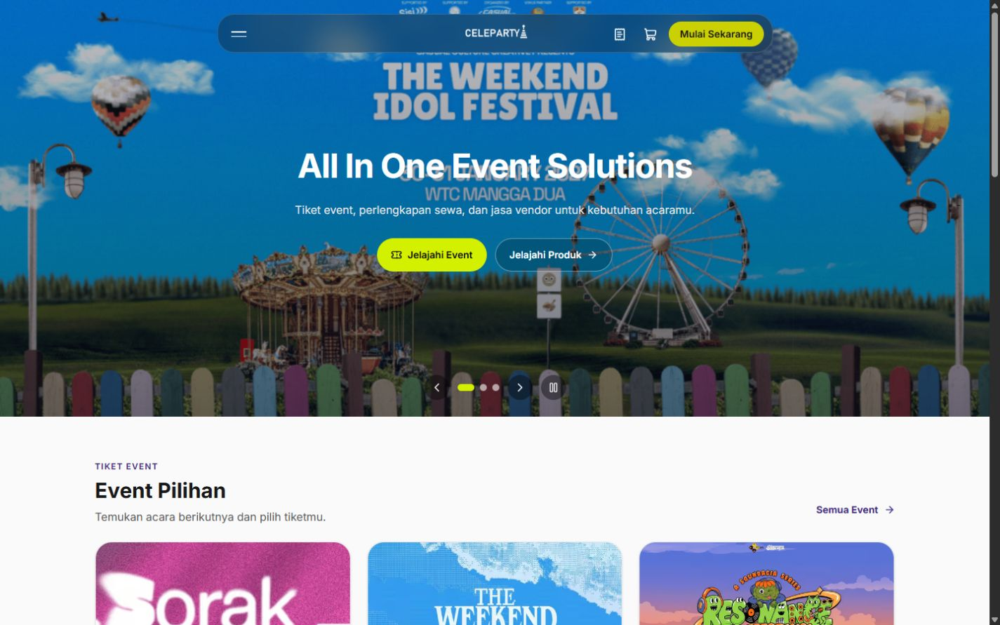
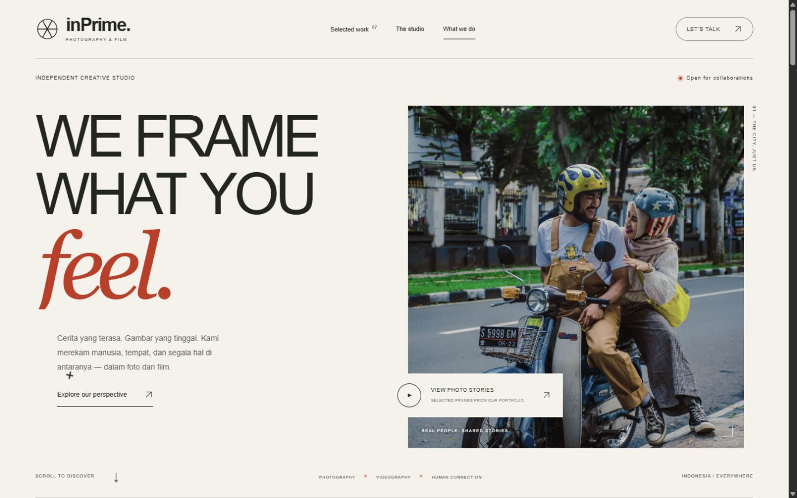
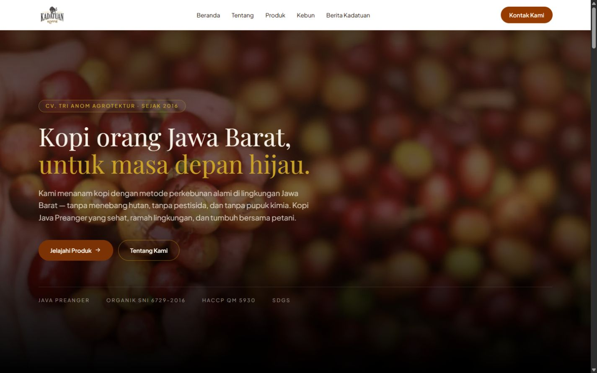
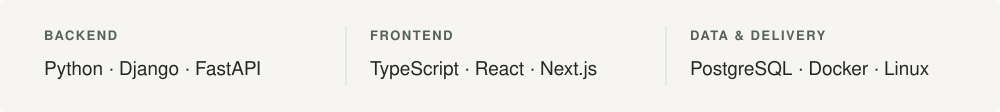

<!-- Profile README for github.com/ariefmavlana. Keep project descriptions grounded in shipped work and public source. -->

<picture>
  <source media="(max-width: 600px)" srcset="./assets/header-mobile.svg" />
  
</picture>

  <a href="https://mavlana.space"><strong>View portfolio</strong></a> &nbsp;·&nbsp;
  <a href="https://www.linkedin.com/in/arief-maulana-330142137">LinkedIn</a> &nbsp;·&nbsp;
  <a href="#selected-work">Selected work</a> &nbsp;·&nbsp;
  <a href="#engineering-approach">Engineering approach</a>

I build **web applications with Python and TypeScript**, from interfaces and APIs to data models and deployment. Based in **Bandung, Indonesia**, my work spans event platforms, business websites, and engineering tools for AI-assisted development.

My focus is on maintainable systems, clear user experiences, and decisions that another engineer can understand and review.

## Selected work

A selection of web products, public source code, and reusable engineering guidance.

### Celeparty

Event platform bringing together **event tickets, equipment rentals, and vendor services** in one place.

[Visit Celeparty →](https://celeparty.com/)

### Engineering tools & applications

| Project & links | What to explore |
| :-- | :-- |
| **[MAVL Skills](https://github.com/ariefmavlana/mavl-skills)** | Versioned engineering practices, agent guidance, and templates for full-stack and AI-assisted development. |
| **[Mavlana Car Dealer](https://github.com/ariefmavlana/mavlana-cardealer)** | Vehicle catalog website built with TypeScript and Next.js, with Cloudflare tooling. |
| **Mavlana Weather** · [Demo](https://mavlana-weather.vercel.app/) · [Source](https://github.com/ariefmavlana/mavlana-weather) | Weather dashboard with forecasts and air-quality views. The map currently displays a provider API-key watermark. |
| **[Mavlana Coin](https://github.com/ariefmavlana/mavlana-coin)** | Cryptocurrency price and trend tracker built with Next.js and Tailwind CSS. |

### Websites & interactive studies

<table>
  <tr>
    <td width="50%" valign="top">
      <a href="https://inprime-studio.vercel.app/"> <strong>inPrime Studio</strong></a> 
      Photography, film, and visual production.
    </td>
    <td width="50%" valign="top">
      <a href="https://kadatuan-koffie.vercel.app/"> <strong>Kadatuan Koffie</strong></a> 
      Java Preanger coffee, origins, and farming.
    </td>
  </tr>
</table>

| Project | What to explore |
| :-- | :-- |
| [**3D Portfolio**](https://3d-mavlana-portfolio.vercel.app/) | An interactive 3D portfolio with an avatar-led presentation. |
| [**GSAP Study**](https://gsap-mavlana.vercel.app/) | An animation-focused web experiment. |
| [**GSAP Portfolio**](https://mavlana-portfolio-gsap.vercel.app/) | A typography-led portfolio exploring motion and page transitions. |
| [**Personal portfolio**](https://mavlana.space) | React, JavaScript, Tailwind CSS, and Three.js. [Source](https://github.com/ariefmavlana/mavlana-arief). |

Additional project: Stock Tracker

[**Mavlana Stock Tracker**](https://mavlana-stock-tracker.vercel.app/) — a stock-tracking application. The demo returned HTTP 500 when checked on 23 November 2026. [Browse the source](https://github.com/ariefmavlana/mavlana-stock_tracker).

[Browse all repositories →](https://github.com/ariefmavlana?tab=repositories)

## Technical focus

<picture>
  <source media="(max-width: 600px)" srcset="./assets/stack-mobile.svg" />
  
</picture>

| Area | Technologies & practices |
| :-- | :-- |
| **Backend & APIs** | Python · Django / DRF · FastAPI · SQLAlchemy · Node.js |
| **Frontend** | TypeScript · JavaScript · React · Next.js · Vue / Nuxt · Tailwind CSS |
| **Data & delivery** | PostgreSQL · Prisma · Docker · Nginx · Linux · Git |
| **Applied AI** | LLM-powered features · Model Context Protocol · CrewAI · Agent workflows |
| **Interactive web** | Three.js · GSAP |

Further experience & current exploration

- **Other frameworks:** Flask, Express, NestJS, Spring Boot, HTMX, Alpine.js, and shadcn/ui.
- **Development tools:** uv, pnpm, Bun, npm, Figma, and VS Code.
- **Exploring:** applied machine learning with PyTorch / TensorFlow, plus Arduino and Raspberry Pi projects.

## Engineering approach

- **Start with the problem.** Inspect the existing system, clarify the scope, and define what a successful change needs to do.
- **Keep boundaries clear.** Make interfaces, validation, authentication, data access, and deployment understandable to the next maintainer.
- **Verify the result.** Use focused tests, type checks, builds, and review where they provide meaningful evidence.
- **Make trade-offs reviewable.** Prefer small changes, deliberate dependencies, and documentation that explains important decisions.

### AI-assisted engineering

I use coding agents with explicit requirements, repository context, and review. I check generated changes against the existing design and remain accountable for what ships. [MAVL Skills](https://github.com/ariefmavlana/mavl-skills) collects the reusable guidance behind that workflow.

## Activity

<!-- Refresh with Node.js 24+: node scripts/update-snake.mjs. Requires GitHub authentication and a configured Git commit identity. Publishes to origin/output without GitHub Actions. -->

<picture>
  <source media="(prefers-color-scheme: dark)" srcset="https://raw.githubusercontent.com/ariefmavlana/ariefmavlana/output/github-snake-dark.svg?v=2" />
  <source media="(prefers-color-scheme: light)" srcset="https://raw.githubusercontent.com/ariefmavlana/ariefmavlana/output/github-snake.svg?v=2" />
  
</picture>

## Let's connect

For conversations about **full-stack development, applied AI, and web products**, reach me on [LinkedIn](https://www.linkedin.com/in/arief-maulana-330142137). You can explore more work at [mavlana.space](https://mavlana.space).

I also share live coding and what I'm learning on [TikTok](https://www.tiktok.com/@ariefmavlana).

<!--
  REVIEW QUARTERLY
  [ ] Project descriptions and technical focus still reflect my work?
  [ ] Portfolio, LinkedIn, project demos, and source links resolve?
  [ ] Stock Tracker demo status updated after a fresh check?
  [ ] Header, previews, stack summary, and snake render in both themes and on mobile?
  [ ] Contribution snake refreshed with node scripts/update-snake.mjs?
  [ ] Pinned repositories reflect the work I want visitors to explore first?
-->
